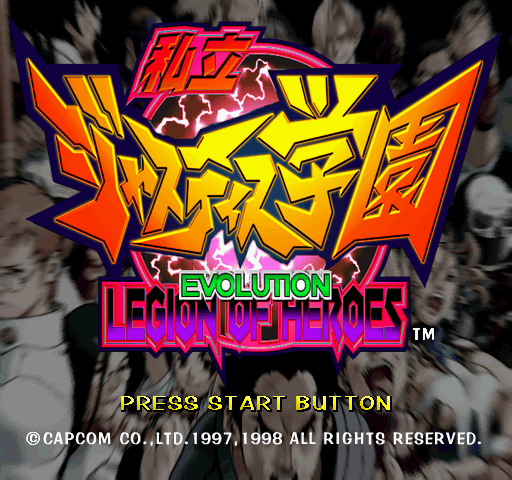
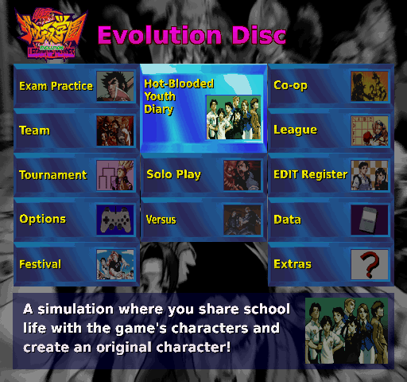
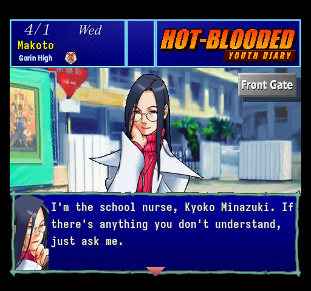
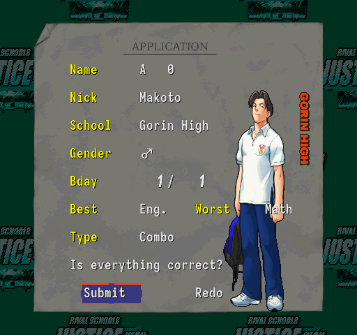
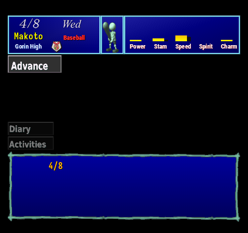
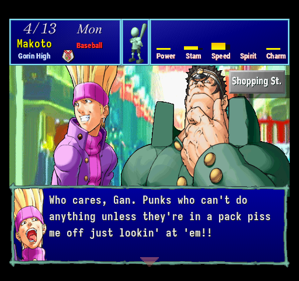

# Shiritsu Justice Gakuen - English patch

Unofficial English fan translation of the unreleased diary mode
(Nekketsu Seishun Nikki/Hot-Blooded Youth Diary) of
*Shiritsu Justice Gakuen: Legion of Heroes*.

The patch applies to the Japanese Evolution Disc (Disc 1, SLPS-01240).

This repository holds no game data. You will have to get a dump and patch it
yourself!

## Screenshots

  
  

  
  

  
  

  
  

## What is translated

- All diary-mode story text.
- Diary-mode menus, hub, calendar, status, training, map and location
  names, save and load screens.
- Character creation and name entry. The name entry takes Latin letters.
- The entrance exam and the 30 exam lessons, with their graphics.
- Festival minigame menus, rules pages and HUD.
- Pause menus, system messages, the EDIT Register and command cards.
- School anthems (romaji and English) and the diary staff roll.
- Fight callouts in diary-mode fights, taken from the USA release.

Out of scope (covered by the Western release):
- Solo mode story (chapter cards, endings).
- Versus and Team mode content.

The loading-screen art is not translated, to keep the original art.

## What is tested

I did a complete run-through of the diary mode twice.
Not every route/school has been manually checked, so any corrections are
welcome.

## Applying the patch

Download the zip from the Releases page.
It holds the same patch in two formats, a small Python patcher and a README.

The patch expects the Redump dump of Disc 1, one MODE2/2352 track:

| file                                                                              | size      | CRC32    |
|-----------------------------------------------------------------------------------|-----------|----------|
| Shiritsu Justice Gakuen - Legion of Heroes (Japan) (Disc 1) (Evolution Disc).bin  | 648190032 | 078c9d65 |

- MD5: `fa674d2a7148832a0170b2d873111d3d`
- SHA-1: `f4ac57a59f2fabce5b4d1454f73aef723980cc43`

Use one of these:

- `.bps` with [Rom Patcher JS](https://www.marcrobledo.com/RomPatcher.js/)
  in a browser, with Flips, or with `apply_patch.py`.
- `.ppf` with PPF-O-Matic, `apply_patch.py`, or an emulator that loads PPF
  patches.

With Python 3 on any system:

    python3 apply_patch.py justice-en-VERSION.bps "Shiritsu Justice Gakuen - Legion of Heroes (Japan) (Disc 1) (Evolution Disc).bin"

This writes `Shiritsu Justice Gakuen (English).bin` and a `.cue` next to
the original. The original is not changed. The patcher checks the CRC32
first. If the check fails, your dump differs from the Redump one. A dump
converted to .ecm, .chd or .iso has to be converted back to a raw .bin/.cue
first.

## Building from source

See [BUILDING.md](BUILDING.md) for building the image from your own
dumps and for the translation file format.

## Credits

Translation, tools and testing: Sergei Akhmatdinov (sakhmatd).

## License

Copyright 2026 Sergei Akhmatdinov (sakhmatd).

- Code in `tools/`: Apache License 2.0 (`LICENSE`).
- English translation text: Creative Commons
  BY-NC-SA 4.0 (`LICENSE-TEXT`).
- The Japanese text quoted in the translation files and the game itself
  belong to Capcom. They are not covered by these licenses.

This is an unofficial fan project, not affiliated with Capcom.

